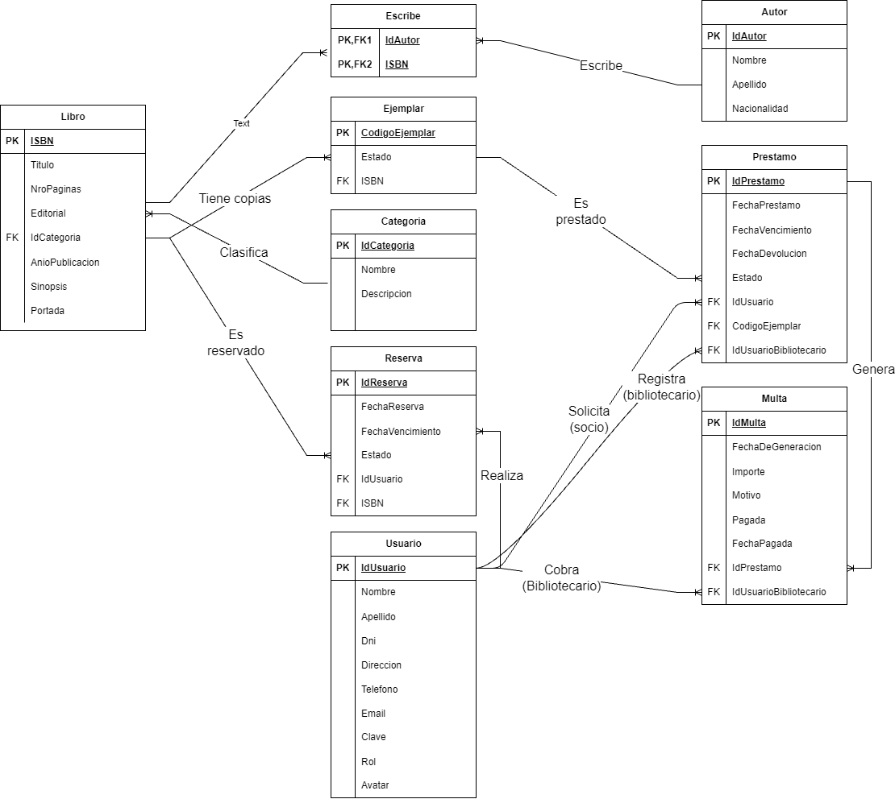

# 📚 BiblioTeca - Sistema de Gestión de Alquiler de Libros

Sistema web desarrollado en **ASP.NET Core MVC** que resuelve la problemática de la gestión manual de préstamos en bibliotecas. Permite administrar el catálogo, controlar el stock físico (ejemplares), gestionar préstamos con fechas de vencimiento, cobrar multas por atrasos y administrar reservas de libros sin stock.

---

## 👥 Integrantes del Grupo

- **Cuello Rafael Nicolas** - *nicolascuello12@gmail.com* - [@RafaCod0011](https://github.com/RafaCod0011)

---

## 📝 Descripción del Problema y Solución

**Problemática:** Las bibliotecas tradicionales suelen manejar sus inventarios y préstamos en planillas o cuadernos, lo que genera pérdida de libros, falta de control sobre quién tiene cada ejemplar, devoluciones tardías sin penalización y dificultad para los socios al saber si un libro está disponible o reservarlo.

**Solución:** Se desarrolló una plataforma centralizada donde:

- **Socios:** Pueden explorar el catálogo, reservar libros sin stock y consultar sus préstamos y multas mediante una API REST.
- **Bibliotecarios:** Pueden registrar préstamos y devoluciones, gestionar el stock físico y cobrar multas.
- **Administradores:** Tienen control total, incluyendo la gestión de usuarios y la eliminación de registros.

---

## 📐 Modelo de Datos

## 📋 Matriz de Evidencias

A continuación se detalla dónde y cómo se implementaron los requerimientos mínimos obligatorios de la cátedra.

| Requerimiento Mínimo                              |   Estado    | Enlace al Código / Controladores                                     | Evidencia (Captura / GIF / Video)                                    |
| :------------------------------------------------ | :---------: | :------------------------------------------------------------------- | :------------------------------------------------------------------- |
| **1. Modelo de Datos: 6+ tablas, 1:N y N:M**      | ✅ Cumplido | [Script SQL](./Database/script.sql) / [Modelos](./Models/)           | DER adjunto en `/docs/der.png`. Relación N:M en tabla `Escribe`.     |
| **2. Login, Roles y Avatar**                      | ✅ Cumplido | [UsuarioController.cs](./Controllers/UsuarioController.cs)           | [🖼️ Ver Captura de Perfil](./docs/Evidencias/perfil.png)                        |
| **3. Manejo de Archivos (Extra al Avatar)**       | ✅ Cumplido | [LibroController.cs](./Controllers/LibroController.cs)               | <a href="https://youtu.be/Qrbn31PE5bk" target="_blank">🎥 Portada de Libro</a>       |
| **4. ABM en Vue.js + AJAX (Sin recargar página)** | ✅ Cumplido | [Usuario/Index.cshtml](./Views/Usuario/Index.cshtml)                 | [🎥 Ver Video: ABM Usuarios](https://youtu.be/RIff_OzWZNs)           |
| **5. Paginado por Servidor**                      | ✅ Cumplido | [LibroController.cs](./Controllers/LibroController.cs)               | [🖼️ Ver Captura de Paginación](./docs/Evidencias/paginacion.png)     |
| **6. Búsqueda Asíncrona (Select2 AJAX)**          | ✅ Cumplido | [Prestamo/Create.cshtml](./Views/Prestamo/Create.cshtml)             | [🎥 Ver Video: Búsqueda](https://youtu.be/ijV8LuTL-cQ)               |
| **7. Web API REST con JWT**                       | ✅ Cumplido | [Api/LibroApiController.cs](./Controllers/Api/LibroApiController.cs) | [🖼️ Ver Captura de Bearer Token](./docs/Evidencias/bearer-token.png) |

---

## 🛠️ Tecnologías Utilizadas

- **Backend:** C# con ASP.NET Core MVC (.NET 8 o superior).
- **Base de Datos:** MySQL (ADO.NET con `MySqlConnector`).
- **Frontend:** HTML5, CSS3, Bootstrap 5, JavaScript (jQuery).
- **Framework Reactivo:** Vue.js 3 (para el ABM de Usuarios).
- **Seguridad:** Cookies Authentication (Web) + JWT Bearer (API).
- **Librerías JS:** Select2 (búsqueda asíncrona), Notyf (notificaciones), FontAwesome (iconos).

---

## 📌 Notas Adicionales de Implementación

- **Reglas de Negocio en Préstamos:** El sistema bloquea la creación de un préstamo si el socio tiene multas pendientes, si ya tiene 3 préstamos activos, o si intenta llevar más de una copia del mismo libro.
- **Vencimiento:** Los préstamos tienen una duración estricta de 15 días.
- **Multas:** Se generan automáticamente al registrar la devolución si la fecha real supera la fecha de vencimiento ($500 por día de atraso).
